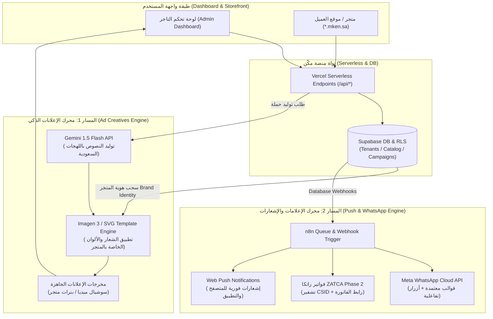

# 📑 التقرير التنفيذي والمعماري: تقييم Google Pomelli والبديل المعماري لمنصة مكِّن (Mken SaaS Engine)

---

## 🎯 1. الموجز التنفيذي (Executive Summary)

تُعد أداة **Google Pomelli** منتجاً تجريبياً واعداً من مختبرات جوجل (**Google Labs**) لتوليد الهويات والحملات التسويقية، إلا أنها **غير قابلة للربط البرمجي المباشر** كمعالج إعلانات أو إشعارات مدمج داخل منصة **مكِّن** للأسباب الجوهرية التالية:
1. **غياب واجهات برمجة التطبيقات المؤسسية (Public Enterprise APIs):** الواجهة مغلقة وتفاعلية ومصممة للاستخدام اليدوي المباشر، ولا تدعم الاستدعاءات البرمجية غير المرئية (Headless APIs).
2. **انعدام دعم تعدد المستأجرين (Multi-Tenancy):** لا تدعم عزل العلامات التجارية أو تخصيص النطاقات الفرعية (`*.mken.sa` / `*.mken.live`).
3. **مخاطر الامتثال وتوطين البيانات:** عدم توافق البيئات التجريبية السحابية الخارجية مع متطلبات **نظام حماية البيانات الشخصية السعودي (PDPL)** وضوابط **الهيئة السعودية للبيانات والذكاء الاصطناعي (SDAIA)**.

### 💡 البديل المعماري المعتمد والمستدام:
تأسيس **محرك إعلانات وتنبيهات ذكي داخلي (Native In-House Engine)** يعتمد على:
* **توليد المحتوى:** سحابة `Vertex AI` / `Gemini 1.5 Flash API` لتوليد النصوص التسويقية باللهجات المحلية المناسبة لكل نشاط من الـ 21+ قطاعاً.
* **توليد التصاميم البصرية:** دمج `Imagen 3 API` ومحرك قوالب ديناميكي (SVG / Canvas / Bannerbear) يسحب هوية المتجر المخزنة في جدول `tenants` بقاعدة بيانات Supabase.
* **إدارة وتوزيع الإشعارات:** محرك الأتمتة **n8n** المرتبط بـ **Meta WhatsApp Cloud API** و **Supabase Database Webhooks** لضمان أعلى معايير الخصوصية والأداء والامتثال.

---

## 🏗️ 2. التحليل الفني والمعماري: مقارنة شاملة

| المحور المعماري | واقع أداة Google Pomelli | متطلبات منصة مكِّن (Mken SaaS Engine) | التوافق الفني |
| :--- | :--- | :--- | :---: |
| **واجهات التكامل (API Availability)** | واجهة ويب تفاعلية مغلقة (No Public REST/GraphQL API) موجهة للمستخدم النهائي. | ربط خلفي غير مرئي (Headless API) لمعالجة الطلبات آلياً عبر Vercel Serverless و n8n. | ❌ **غير متوافق** |
| **تعدد المستأجرين (Multi-Tenancy)** | حسابات فردية يدوية منفصلة لا تدعم النطاقات الفرعية (`*.mken.sa`). | عزل كامل للعلامات التجارية والبيانات عبر Supabase RLS لـ 21+ قطاعاً تشغيلياً. | ❌ **غير متوافق** |
| **توطين وامتثال البيانات (SDAIA / PDPL)** | بيئة تجريبية سحابية غير مخصصة للسيادة الرقمية المحلية. | توافق تام مع ضوابط حماية البيانات بالسعودية وتخزين سجلات الحملات محلياً. | ⚠️ **عالي المخاطر** |
| **المعالجة المؤتمتة للإعلانات (Ad Processing)** | تستلزم إدخال الرابط يدوياً وتوليد منشورات للتنزيل اليدوي فقط. | إنشاء عروض مخصصة بناءً على سلة المتروكات وحجوزات المواعيد وتوزيعها برمجياً فوراً. | ❌ **غير متوافق** |

---

## 🧭 3. مسارات المعالجة المعمارية (Dual-Track Architecture)

### المسار الأول: إذا كان القصد «معالج إعلانات» (Ad Creatives & Marketing Engine)
* **الهدف:** تمكين تجار مكِّن (الصالونات، العيادات، قطاع الصيانة، المطاعم، المتاجر) من إنشاء حملات تسويقية وصور منتجات مخصصة تلقائياً.
* **البديل التقني المعتمد:**
  1. استدعاء **Gemini API** لتوليد النصوص التسويقية بنبرة المتجر (Brand Tone) واللهجات السعودية الملائمة للقطاع.
  2. دمج النصوص مع **Imagen 3 API** أو محرك قوالب ديناميكي (SVG / Canvas / Bannerbear) يسحب الهوية من جدول `tenants` (الشعار، كود الألوان الأساسي، الخطوط).
  3. توليد تصاميم إعلانية جاهزة برمجياً بضغطة زر واحدة من لوحة التحكم.

### المسار الثاني: إذا كان القصد «معالج إعلامات / إشعارات» (Push / Transactional Notifications)
* **الهدف:** معالجة الإشعارات التشغيلية اللحظية (تأكيد الحجوزات، فواتير زاتكا، تتبع الفنيين الميدانيين، استعادة السلات المتروكة).
* **البنية المعتمدة:**
  1. الاعتماد حصرياً على **n8n Workflow Engine** المرتبط بـ **Meta WhatsApp Cloud API** و **Supabase Database Webhooks**.
  2. إدارة حدود الإرسال (Rate Limiting) وتسجيل تقارير التسليم (Delivery Receipts).
  3. ربط الروابط المباشرة بفواتير **ZATCA** الإلكترونية المشفرة.

---

## 📊 4. جدول الإنجازات وحالة العمل (Accomplishments & Work Status)

| الركيزة البرمجية / النمط التشغيلي | الإنجازات المكتملة | المهام قيد التنفيذ (In-Progress) | المهام المعلقة / المخططة | مؤشر الحالة |
| :--- | :--- | :--- | :--- | :---: |
| **نمط الحجوزات** *(صالونات، سبا، عيادات)* | بناء تقويم المواعيد المباشر، وتخصيص الموظفين والخدمات، وحساب الفترات الزمنية (`slotDuration`). | تكامل التنبيه التلقائي عبر الواتساب لتأكيد وإلغاء المواعيد وتحديث الحالة. | ميزة إعادة الاستهداف الذكي للمواعيد المتروكة عبر الذكاء الاصطناعي. | 🟢 **مستقر** |
| **نمط الخدمات الميدانية** *(صيانة، نظافة، تشغيل)* | جدولة المهام وتحديد مواقع الفرق الميدانية جغرافياً، وتخصيص طلبات الخدمة المتنقلة. | بوابة الفنيين المتجاوبة للأجهزة الذكية (`PWA Mobile View`) وإشعارات المهام. | توجيه المسارات الذكي للحد من استهلاك الوقود وزمن الوصول. | 🟡 **قيد التطوير** |
| **نمط إدارة المشاريع** *(استشارات، تقنية، تدريب)* | هيكلة فترات التسليم، إصدار عروض الأسعار، وتوثيق العقود والاتفاقيات. | ربط المدفوعات الجزئية والدفعات المرحلية عبر بوابة ميسر (`Moyasar`). | إصدار مستخلصات المشاريع المتوافقة مع متطلبات الفوترة المعتمدة. | 🟡 **قيد التطوير** |
| **نمط التجارة والطلبات** *(مطاعم، تجزئة، كافيهات)* | إدارة المخزون متعدد الفروع، نقاط البيع السحابية (`POS`)، والسلة الديناميكية. | تسريع مزامنة الطابعات الحرارية عبر بروتوكول الشبكة المحلي (`ESC/POS`). | محرك الخصومات الديناميكي وحملات استعادة السلات المتروكة آلياً. | 🟢 **متقدم** |
| **الفوترة الإلكترونية** *(ZATCA Compliance)* | المرحلة الأولى (توليد QR Code مشفر متوافق بالكامل مع الفاتورة الضريبية والمبسطة). | الربط المباشر للمرحلة الثانية (`CSID Onboarding` عبر `ECDSA P-256 / secp256r1`). | مراجعة التشفير الشامل والتوليد التلقائي لملفات `XML UBL 2.1`. | 🟡 **حرج / أولوية** |
| **البنية التحتية وتعدد المستأجرين** | عزل البيانات بنسبة 100% عبر Supabase RLS وتوليد النطاقات الفرعية وتفعيل الحماية. | إعداد قوالب سير العمل المؤتمتة (`Workflows`) على خوادم n8n المستقلة. | بناء محرك توليد الحملات التسويقية الداخلي البديل لأدوات الويب الخارجية. | 🟢 **مستقر** |

---

## 🛡️ 5. التحديات والتنبيهات التقنية (Risk & Engineering Alerts)

> [!CAUTION]
> **انعدام واجهات API في الأدوات التجريبية الخارجية:**
> الاعتماد على أدوات خارجية غير مزودة بـ REST APIs موثقة يهدد استقرار بنية المنصة المعمارية؛ لذلك يُمنع ربط أي خدمات تجريبية لا توفر اتفاقيات مستوى خدمة معتمدة (Enterprise SLA).

> [!IMPORTANT]
> **تأمين التوقيع الرقمي لهيئة الزكاة والضريبة والجمارك (ZATCA Phase 2):**
> يتطلب تشفير الفواتير بواسطة شهادات التشفير الرقمي (CSID) عبر مفاتيح `ECDSA secp256k1` / `secp256r1` عناية فائقة في حفظ المفاتيح الخاصة لكل مستأجر على حدة في خزنة آمنة مشفرة (Secure Secrets Vault / Supabase Vault) لمنع اختراق التوقيع.

> [!WARNING]
> **حدود الإرسال وسياسات Meta Cloud API:**
> تزايد أعداد الرسائل التسويقية المجمعة يتطلب جدولة الرسائل عبر طوابير غير متزامنة (Message Queuing عبر Redis أو n8n Queue Mode) لحماية أرقام المستأجرين من الحظر والحفاظ على تقييم رقم الأعمال عالي الجودة (High Quality Rating).

> [!CAUTION]
> **حماية البيانات المشتركة (Supabase RLS Leaks):**
> الحفاظ على تطبيق صارم لقواعد أمان الصفوف (Row Level Security) لمنع تسرب البيانات بين المتاجر عند استدعاء أي محركات خارجية أو نماذج ذكاء اصطناعي عبر تمرير `tenant_id` المحقق فقط.

---

## 🚀 6. الخطوات القادمة وخطة العمل (Strategic Next Steps & Roadmap)

1. **اعتماد محرك ذكاء اصطناعي داخلي عبر API:**
   * بناء نقطة نهاية مخصصة في المنصة (`/api/ai/marketing-generate.js`) تستدعي `Gemini 1.5 Flash` برمجياً.
   * تزويد النموذج بنبرة المتجر (`Brand Tone`) وتفاصيل المنتج لتوليد نصوص الإعلانات تلقائياً دون مغادرة لوحة التحكم.
2. **استكمال متطلبات المرحلة الثانية من الفوترة الإلكترونية (ZATCA Phase 2):**
   * فحص بيئة المحاكاة (Sandbox) لـ ZATCA والتأكد من توليد الهاش التشفيري (`Invoice Cryptographic Stamp`) لكل مستأجر وتوليد ملفات `UBL 2.1 XML`.
3. **أتمتة إرسال العروض التسويقية واستعادة العملاء عبر n8n:**
   * تجهيز تدفق عمل يستهدف العملاء الذين لم يقوموا بالحجز أو الشراء خلال 30 يوماً عبر قوالب معتمدة مسبقاً من واتساب مع روابط مخصصة.

