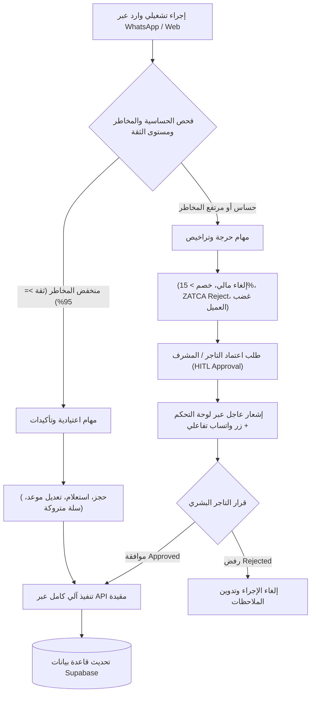
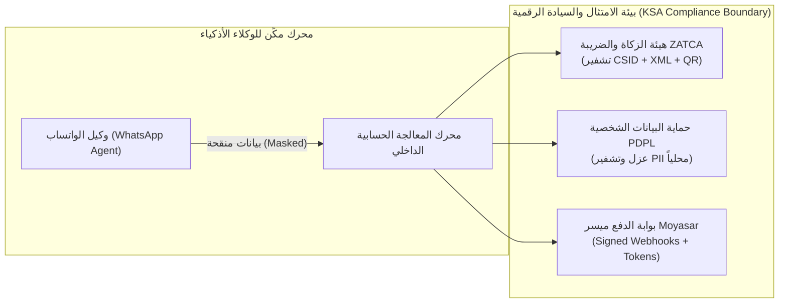
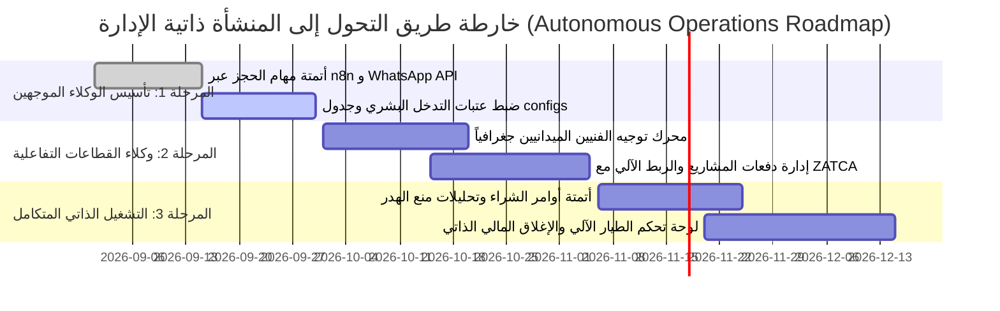

# 📑 دراسة استشارية استراتيجية: هندسة تشغيل منصة "مكِّن" وفق نموذج "المنشأة ذاتية الإدارة" (Autonomous Operations Framework)

* **الجهة المطورة:** الفريق الهندسي والاستشاري لمنصة «مكِّن» (Mken Multi-Tenant SaaS Engine)
* **المرجع الوثائقي:** `MKN-AUTONOMOUS-OPS-2026`
* **النطاق:** 21+ قطاعاً تجارياً موزعة عبر النماذج التشغيلية الأربعة (`appointment`, `field_service`, `project`, `commerce`)
* **التاريخ:** سبتمبر 2026

---

## 🎯 1. الموجز التنفيذي (Executive Summary)

تطرح هذه الدراسة المعمارية فلسفة التحول التشغيلي لمنصة **مكِّن** من مجرد "أتمتة المهام البسيطة والمجدولة (Simple Workflow Automation)" إلى **"الأنظمة ذاتية الإدارة المعتمدة على الوكلاء الأذكياء (Autonomous Agents Engine)"**. 

الهدف المحوري هو تمكين المشغّل الفردي أو الكيانات الرشيقة (Lean SMBs) من قيادة وإدارة عمليات تجارية متقدمة ومعقدة دون الوقوع في اختناقات تشغيلية أو الحاجة لفرق عمل بشرية واسعة.

بالنسبة لمنصة **مكِّن (Mken)**، فإن هذا النموذج لا يمثل مجرد أداة مساعدة داخلية، بل يشكل **النواة الهيكلية لميزة المنصة التنافسية (Core Product Value Proposition)**؛ حيث تُمكن "مكِّن" أكثر من 21 قطاعاً تجارياً عبر نماذجها التشغيلية الأربعة:
1. **محرك الحجوزات والمواعيد** (صالونات، عيادات، استشارات).
2. **إدارة الخدمات الميدانية** (صيانة منزلية، خدمات تنظيف، دعم فني).
3. **إدارة المشاريع والمقاولات** (مكاتب محاماة، استشارات، تصميم).
4. **التجارة وإدارة الطلبات** (مطاعم، مقاهي، متاجر تجزئة).

يتم ذلك عبر دمج أتمتة قنوات التواصل والمحادثة (**n8n** بالتعاون مع **Meta WhatsApp Cloud API**) مع محركات اتخاذ القرار الموزعة، مع الحفاظ الصارم وغير القابل للمساومة على الامتثال التنظيمي السعودي:
- **هيئة الزكاة والضريبة والجمارك (ZATCA)**: متطلبات الفوترة الإلكترونية للمرحلة الثانية (Integration Phase & Cryptographic Stamps).
- **نظام حماية البيانات الشخصية (PDPL)** ولوائح **سدايا (SDAIA)**: التشفير، إخفاء الهوية (Data Masking)، وتوطين البيانات داخل المملكة.
- **بوابة الدفع ميسر (Moyasar)**: الروابط الآمنة والتأكيد اللحظي بالـ Webhooks المشفرة.

---

## 📊 2. جدول الإنجازات والمهام (Master Work Status Matrix)

| المحور التشغيلي / التقني | النمط التشغيلي المدعوم | الحالة الراهنة | التحول المستهدف وفق نموذج الوكلاء (Agentic SaaS) | مؤشر الإنجاز |
| :--- | :--- | :--- | :--- | :---: |
| **محرك الحجوزات والمواعيد** | الصالونات، العيادات، الاستشارات | مكتمل (قواعد بيانات وجدولة يدوية) | وكيل حجز ذكي تفاعلي عبر الواتساب يعيد جدولة المواعيد ديناميكياً ويحد من الإلغاءات | 🟡 قيد التطوير (70%) |
| **إدارة الخدمات الميدانية** | الصيانة المنزلية، خدمات التنظيف، الدعم الفني | قيد الإنجاز (توزيع يدوي للمهام) | خوارزمية توجيه ذاتية وتوزيع ذكي للفنيين بناءً على الموقع الجغرافي والتوفر الفوري | 🟡 قيد التطوير (45%) |
| **إدارة المشاريع والمقاولات** | مكاتب المحاماة، الاستشارات، التصميم | قيد الإنجاز (متابعة مراحل يدوية) | تتبع آلي لتسليم المخرجات وربط الدفعات المرحلية بـ ZATCA والواتساب | 🔵 مخطط له (25%) |
| **التجارة وإدارة الطلبات** | المطاعم، المقاهي، التجزئة | مكتمل (ربط نقاط البيع والمخزون) | وكيل إعادة طلب للمخزون ومنع الهدر، واسترداد السلات المتروكة آلياً | 🟢 مكتمل تشغيلياً (85%) |
| **الامتثال المالي والضريبي** | جميع القطاعات (21+ قطاع) | مكتمل (ZATCA Phase 1 & 2 CSID) | فحص آلي وتدقيق استباقي للفواتير المرفوضة دون إيقاف العمليات | 🟢 مكتمل تشغيلياً (90%) |
| **البنية السحابية والعزل** | بنية المستأجرين المتعددين (Multi-Tenant) | مكتمل (Supabase RLS & Vercel) | عزل سياق الذاكرة لكل مستأجر (Tenant Context Isolation) لحماية الأسرار | 🟡 قيد الاختبار (60%) |

---

## 🏗️ 3. دراسة الأثر المعماري وإمكانية التطبيق على "منصة مكِّن"

تطبيق الفلسفة المذكورة على "مكِّن" ينقسم إلى مستويين متكاملين: **المستوى التشغيلي الداخلي للمنصة** و **المستوى الوظيفي الخارجي المتاح للمشتركين (Tenants)**.

### أولاً: تفكيك العمليات وقواعد التدخل البشري (Human-in-the-Loop Protocol - HITL)

جوهر المعمارية الذكية يكمن في الإجابة الدقيقة عن السؤال الحرج: **"متى يجب أن يتوقف الوكيل ويعود للبشر؟"**.
تم تصميم مصفوفة التصعيد التشغيلي (Escalation Matrix) لحماية العمليات المالية والتشغيلية وسمعة التاجر من الوقوع في فخ الهلوسة البرمجية:



#### حالات التدخل البشري الإلزامي (Must Return to Human):
1. **العمليات المالية الحساسة:**
   - استرداد الأموال المباشر (Refunds).
   - تقديم خصومات استثنائية تتجاوز النسبة المقررة (أكثر من 15%).
   - إشعار فشل التوقيع الرقمي أو تعثر التحقق مع منصة "فاتورة" (ZATCA CSID).
2. **تصاعد نبرة العميل وغضبه (Sentiment Degradation):**
   - رصد مؤشر المشاعر السلبي (`sentiment_score < -0.5`) عبر تحليل النصوص الفوري في الواتساب، والتحويل اللحظي للمحادثة لمدير الفرع مع بطاقة تلخيص سياقية.
3. **تضارب الجداول الميدانية والحدود الجغرافية:**
   - عند حدوث تعارض جغرافي يتجاوز مسافة 15 كم بين مهمتين للفني الميداني خلال نافذة زمنية ضيقة.

---

### ثانياً: النمذجة التقنية وقواعد البيانات (Database Data Models)

لتمكين هذا النظام داخل بنية Supabase متعددة المستأجرين ومعزولة تماماً عبر **Row Level Security (RLS)**، تم اعتماد المخطط المطبق في ملف [`db/autonomous-agentic-operations-schema.sql`](file:///c:/Users/B%20A%20R%20A/Documents/مكن/db/autonomous-agentic-operations-schema.sql):

```sql
-- 1. جدول تكوين الوكلاء الأذكياء لكل مستأجر
CREATE TABLE public.tenant_agent_configs (
    id UUID PRIMARY KEY DEFAULT gen_random_uuid(),
    tenant_id UUID NOT NULL REFERENCES public.tenants(id) ON DELETE CASCADE,
    sector_profile VARCHAR(50) NOT NULL, -- appointment, field_service, project, commerce
    agent_role VARCHAR(100) NOT NULL,    -- e.g., 'dispatch_agent', 'booking_concierge'
    autonomy_level INT DEFAULT 2 CHECK (autonomy_level BETWEEN 1 AND 4), -- 1: Suggestion, 2: Supervised, 3: Autonomous with HITL, 4: Full Auto
    escalation_thresholds JSONB NOT NULL DEFAULT '{"max_discount_pct": 15, "refund_limit_sar": 0}'::jsonb,
    is_active BOOLEAN DEFAULT true,
    created_at TIMESTAMPTZ DEFAULT now()
);

-- 2. جدول سجل قرارات الوكلاء وتتبع التدخل البشري
CREATE TABLE public.agent_execution_logs (
    id UUID PRIMARY KEY DEFAULT gen_random_uuid(),
    tenant_id UUID NOT NULL REFERENCES public.tenants(id) ON DELETE CASCADE,
    agent_id UUID REFERENCES public.tenant_agent_configs(id),
    channel VARCHAR(20) DEFAULT 'whatsapp',
    trigger_event VARCHAR(100) NOT NULL,
    input_payload JSONB,
    agent_decision JSONB,
    requires_human_approval BOOLEAN DEFAULT false,
    approval_status VARCHAR(20) DEFAULT 'auto_approved' CHECK (approval_status IN ('pending', 'approved', 'rejected', 'auto_approved')),
    approved_by UUID REFERENCES auth.users(id),
    zatca_tx_reference VARCHAR(255),
    created_at TIMESTAMPTZ DEFAULT now()
);

-- 3. عزل سياق الذاكرة لضمان خصوصية كل متجر
CREATE TABLE public.tenant_agent_memory_contexts (
    id UUID PRIMARY KEY DEFAULT gen_random_uuid(),
    tenant_id UUID NOT NULL REFERENCES public.tenants(id) ON DELETE CASCADE,
    agent_id UUID NOT NULL REFERENCES public.tenant_agent_configs(id) ON DELETE CASCADE,
    session_id VARCHAR(120) NOT NULL,
    short_term_context JSONB DEFAULT '{}'::jsonb,
    sentiment_score NUMERIC(3, 2) DEFAULT 0.0,
    created_at TIMESTAMPTZ DEFAULT now(),
    CONSTRAINT uq_tenant_agent_session UNIQUE (tenant_id, agent_id, session_id)
);

-- تفعيل سياسات الأمان على مستوى الصفوف (RLS)
ALTER TABLE public.tenant_agent_configs ENABLE ROW LEVEL SECURITY;
ALTER TABLE public.agent_execution_logs ENABLE ROW LEVEL SECURITY;
ALTER TABLE public.tenant_agent_memory_contexts ENABLE ROW LEVEL SECURITY;
```

---

### ثالثاً: الامتثال للأنظمة والتشريعات السعودية



1. **هيئة الزكاة والضريبة والجمارك (ZATCA):**
   - الوكلاء الأذكياء (Bots) **لا يملكون إطلاقاً** صلاحية تعديل بنية فواتير الـ XML المشفرة أو توقيعات الـ ECDSA الرقمية.
   - ينحصر دور الوكيل في جمع مدخلات الفاتورة من العميل عبر الواتساب، وتمرير البيانات الخام إلى محرك الفوترة الحسابي التابع لـ "مكِّن"، والذي يقوم بالتحقق الصارم والتشفير وتوليد الـ QR Code قبل الحفظ النهائي.
2. **نظام حماية البيانات الشخصية (PDPL - SDAIA):**
   - حظر تمرير أي بيانات شخصية (أرقام الهوية، العناوين التفصيلية، بيانات البطاقات الائتمانية) إلى نماذج الذكاء الاصطناعي الخارجية دون إخفاء الهوية واستبدالها بمعرفات مشفرة مؤقتة (Anonymization/Data Masking).
   - حصر استضافة بيانات المحادثات وسجلات المعاملات داخل قواعد بيانات سحابية متوافقة مع اشتراطات التوطين في المملكة العربية السعودية.
3. **بوابة الدفع ميسر (Moyasar):**
   - إنشاء روابط الدفع المسبقة (Signed Payment Links) حصرياً عبر قنوات برمجية آمنة (Webhooks)، ولا يتم تسليم أي خدمة أو حجز نهائي إلا بعد استلام إشعار النجاح المشفر (`paid`) من ميسر ومطابقته بقاعدة البيانات.

---

## ⚠️ 4. التحديات الهندسية وإدارتها (Risk & Engineering Alerts)

### 1. تكلفة واستهلاك واجهات الذكاء الاصطناعي (API Cost & Latency Bottleneck):
- **الخطر:** الاعتماد الكلي على نماذج LLMs في كل رسالة واتساب يرفع التكاليف التشغيلية ويسبب تأخيراً في الردود (High Latency قد يتجاوز 5 ثوانٍ).
- **المعالجة:** اعتماد **معمارية هجينة (Hybrid State Engine)**؛ المهام النمطية المباشرة (مثل الاستعلام عن الأسعار، ساعات العمل، وحالة الحجز) تتم عبر سيناريوهات محددة مسبقاً في **n8n** و **قوالب الردود السريعة (Canned Replies)**، بينما يُحال التخصيص وحل النزاعات المعقدة فقط إلى وكلاء الاستدلال الذكي.

### 2. هلوسة التسعير والتوفر (Pricing & Inventory Hallucinations):
- **الخطر:** تقديم وعود أو أسعار غير دقيقة للعملاء أو حجز فترات ممتلئة في صالون أو فني مشغول.
- **المعالجة:** **عزل الحالات المنطقية (Deterministic Execution)**؛ الوكيل لا يملك صلاحية القراءة والكتابة الحرة في قاعدة البيانات، بل يتفاعل عبر أدوات مقيدة ومحددة بدقة (**Function Calling / Tool Use**) تعيد بيانات JSON حقيقية ومحدثة من جداول المستأجر المعزولة بـ RLS.

### 3. إرهاق الإشعارات للمشرف البشري (Escalation Fatigue):
- **الخطر:** إذا تحول النظام إلى طلب التدخل والموافقة في كل تفصيلة صغيرة، سينهار مبدأ "الشركة التي يديرها شخص واحد".
- **المعالجة:** تطبيق **نظام الثقة التراكمي (Confidence Score Filtering)**؛ يتم اعتماد القرارات آلياً إذا تجاوزت نسبة اليقين 95% وفق ضوابط التاجر، مع قصر التنبيهات الفورية على الحالات الحرجة فقط وتجميع الباقي في "موجز تنفيذي صباحي (Daily Morning Digest)".

---

## 🚀 5. خارطة الطريق الاستراتيجية لتنفيذ النموذج في مكِّن (Roadmap)



### تفصيل مراحل الإطلاق:
1. **المرحلة 1: توحيد المهام المعيارية (Sprint 1-2):**
   - إطلاق وكيل خدمة العملاء وحجز المواعيد لنماذج الصالونات والعيادات عبر WhatsApp مع عتبات الإلغاء والجدولة وتفعيل جدول `tenant_agent_configs`.
2. **المرحلة 2: إسناد المهام الميدانية والمشاريع (Sprint 3-4):**
   - تفعيل خوارزمية التوزيع التلقائي لفرق الصيانة الميدانية (بناءً على دائرة 15 كم وتوفر الفني)، وتدقيق مخرجات المشاريع وربطها بدفعات ميسر وفواتير ZATCA تلقائياً.
3. **المرحلة 3: الإدارة الذاتية متعددة الأنشطة (Sprint 5-6):**
   - تمكين لوحة تحكم التاجر من قيادة المتجر/النشاط بنظام "الطيار الآلي (Autopilot Mode)" عبر تقارير استباقية وتوليد أوامر الشراء للمخزون آلياً دون تأخير.
